# Registro de pruebas CP01–CP13

| Dato | Valor |
|---|---|
| Versión probada | v1.1.0 (commit `5205f81`) |
| Frontend | https://bolsa-tec.vercel.app |
| API | https://bolsatec.onrender.com |
| Navegador | Chromium (Playwright) |
| Fecha de ejecución | 2026-11-20 09:11:15 UTC |
| Resultado | **24 de 26 casos aprobados** |

Contraseña de las cuentas de prueba: `Prueba12345`.

## Escritorio (Chromium 1366×768)

Cuentas: estudiante `prueba.cp.estudiante.escritorio.1795165752793@bolsatec.test`, empresa `prueba.cp.empresa.escritorio.1795165752793@bolsatec.test`.

| ID | Caso | Pasos | Datos | Resultado esperado | Resultado obtenido | Estado | Captura |
|---|---|---|---|---|---|---|---|
| CP01 | Registro de estudiante | Abrir /registro → «Soy estudiante» → llenar nombre, teléfono, institución, carrera, correo y contraseña → aceptar términos → «Crear cuenta». | Nombre «Diana López (prueba)», correo prueba.cp.estudiante.escritorio.1795165752793@bolsatec.test, contraseña Prueba12345. | La cuenta se registra con rol estudiante y el sistema confirma la operación. | HTTP 201 «Estudiante registrado correctamente»; rol «estudiante»; redirige a /login. | ✅ Aprobado | [escritorio-CP01.png](escritorio-CP01.png) |
| CP02 | Registro con correo existente | Abrir /registro → «Soy estudiante» → llenar el formulario con el mismo correo de CP01 → «Crear cuenta». | Correo ya registrado: prueba.cp.estudiante.escritorio.1795165752793@bolsatec.test. | El sistema rechaza el registro duplicado y muestra un mensaje. | Mensaje «El correo electrónico ya está registrado»; permanece en /registro. | ✅ Aprobado | [escritorio-CP02.png](escritorio-CP02.png) |
| CP03 | Inicio de sesión correcto | Abrir /login → «Soy estudiante» → correo y contraseña de CP01 → «Iniciar sesión». | Correo prueba.cp.estudiante.escritorio.1795165752793@bolsatec.test, contraseña Prueba12345. | El usuario accede a su panel según el rol. | Redirige a /dashboard/estudiante («Portal del estudiante»); pie «BolsaTec v1.1.0 · 5205f81 · 2026-11-20». | ✅ Aprobado | [escritorio-CP03.png](escritorio-CP03.png) |
| CP04 | Semestre dentro del rango | Mi perfil → Semestre = 1 → «Guardar cambios»; después Semestre = 15 → «Guardar cambios». | Semestre 1 y semestre 15. | La información se guarda y se muestra actualizada. | Semestre 1: «Perfil actualizado correctamente»; semestre 15: «Perfil actualizado correctamente». Valor guardado: 15. | ✅ Aprobado | [escritorio-CP04.png](escritorio-CP04.png) |
| CP05 | Semestre fuera de rango | Mi perfil → Semestre = 16 → «Guardar cambios». Además se envía PUT /api/estudiante/perfil con semestre 16 para revisar la validación del servidor. | Semestre 16. | La validación impide guardar el dato. | Navegador: «Value must be less than or equal to 15.». Servidor: HTTP 400 «El semestre debe estar entre 1 y 15». El semestre sigue en 15. | ✅ Aprobado | [escritorio-CP05.png](escritorio-CP05.png) |
| CP06 | Currículum PDF válido | Mi perfil → «Seleccionar PDF» → elegir el archivo → «Subir currículum». | Curriculum_prueba.pdf (1 página, < 1 KB). | El archivo se asocia al estudiante autenticado. | «Currículum guardado correctamente»; GET /api/estudiante/curriculum: HTTP 200. | ✅ Aprobado | [escritorio-CP06.png](escritorio-CP06.png) |
| CP07 | Archivo que no es PDF | Mi perfil → «Seleccionar PDF» → elegir un archivo .txt. | Curriculum_prueba.txt (texto plano). | El archivo se rechaza y se informa el formato permitido. | Mensaje «Archivo no permitido. Solo se permiten archivos PDF.»; el archivo no se envía. | ✅ Aprobado | [escritorio-CP07.png](escritorio-CP07.png) |
| CP08 | Publicación de vacante | Iniciar sesión como empresa → Mis vacantes → «Nueva vacante» → llenar campos obligatorios → «Publicar vacante». | Empresa prueba.cp.empresa.escritorio.1795165752793@bolsatec.test; título «Desarrollador Web Jr remoto (prueba escritorio)», Remota, Prácticas, salario 6000–8000. | La vacante se registra asociada a esa empresa. | «Vacante publicada correctamente»; estado «activa»; la vacante 20 aparece en «Mis vacantes» de Empresa Pruebas CP (escritorio). | ✅ Aprobado | [escritorio-CP08.png](escritorio-CP08.png) |
| CP09 | Filtro por modalidad | Buscar vacantes → filtro «Remota». | Modalidad = Remota. | Se muestran solo las vacantes de la modalidad seleccionada. | 2 vacante(s), todas con etiqueta «Remota»: sí. Incluye la vacante remota de prueba: sí; oculta la presencial y la híbrida de prueba: sí. | ✅ Aprobado | [escritorio-CP09.png](escritorio-CP09.png) |
| CP10 | Consulta y detalle de vacante | Buscar vacantes → quitar filtro → «Ver detalles» en la vacante remota de prueba. | Vacante «Desarrollador Web Jr remoto (prueba escritorio)». | Se muestran datos principales y detalle de la vacante. | El detalle muestra título, empresa, modalidad, ubicación y descripción (4/4 datos verificados). | ✅ Aprobado | [escritorio-CP10.png](escritorio-CP10.png) |
| CP11 | Postulación a vacante activa | En el detalle de la vacante → «Postularme». | Estudiante prueba.cp.estudiante.escritorio.1795165752793@bolsatec.test; vacante «Desarrollador Web Jr remoto (prueba escritorio)» sin solicitud previa. | Se crea una postulación y se confirma el registro. | HTTP 201 «Postulación enviada correctamente»; el detalle cambia a «Ya te postulaste». | ✅ Aprobado | [escritorio-CP11.png](escritorio-CP11.png) |
| CP12 | Postulación duplicada | Con la misma sesión se intenta postular otra vez a la misma vacante (POST /api/estudiante/postulaciones). | Mismo estudiante y vacante 20. | La segunda solicitud se rechaza por duplicidad. | HTTP 409 «Ya te postulaste a esta vacante»; el estudiante sigue con 1 postulación a esa vacante; el botón muestra «Ya te postulaste». | ✅ Aprobado | [escritorio-CP12.png](escritorio-CP12.png) |
| CP13 | Postulación a vacante cerrada | La empresa cierra una vacante. El estudiante busca la vacante y, con su sesión, envía POST /api/estudiante/postulaciones. | Vacante «Vacante cerrada (prueba escritorio)» (id 19), estado cerrada. | El sistema no permite crear la solicitud. | La vacante cerrada no aparece en la búsqueda (0 resultados). HTTP 409 «La vacante ya no está disponible»; no se crea la postulación. | ✅ Aprobado | [escritorio-CP13.png](escritorio-CP13.png) |

**CP01 — Registro de estudiante**

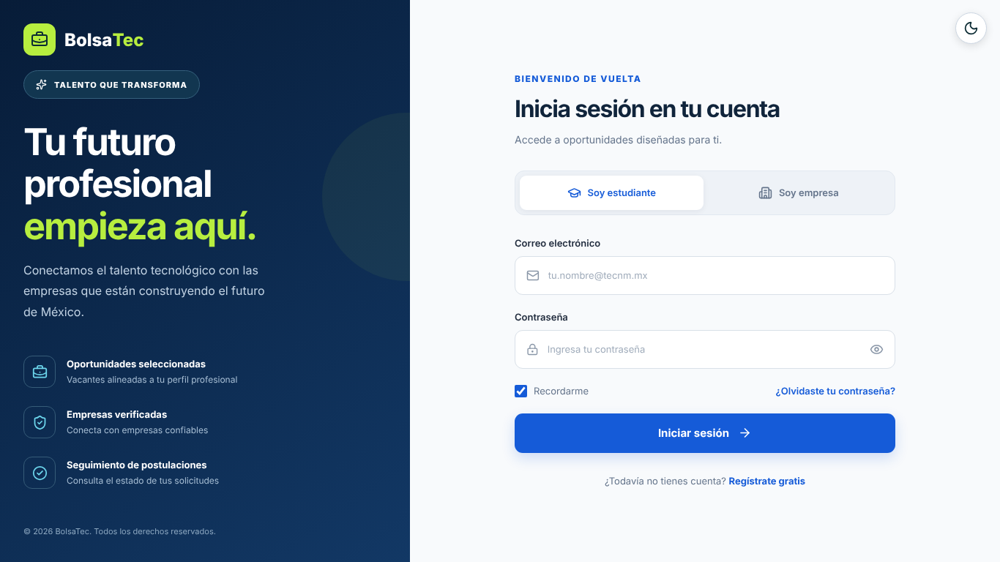

**CP02 — Registro con correo existente**

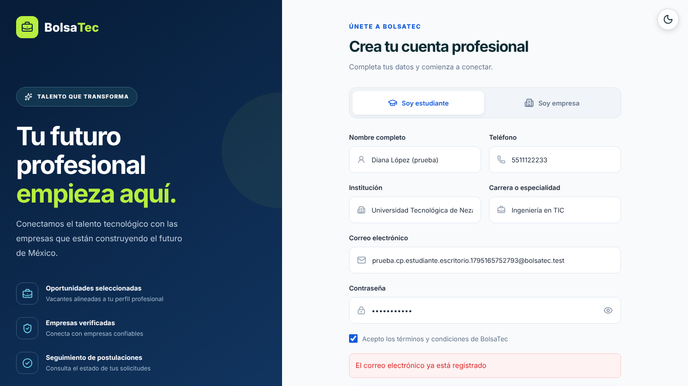

**CP03 — Inicio de sesión correcto**

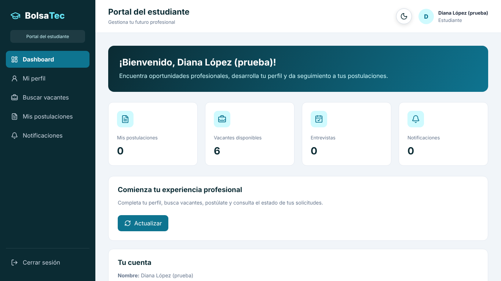

**CP04 — Semestre dentro del rango**

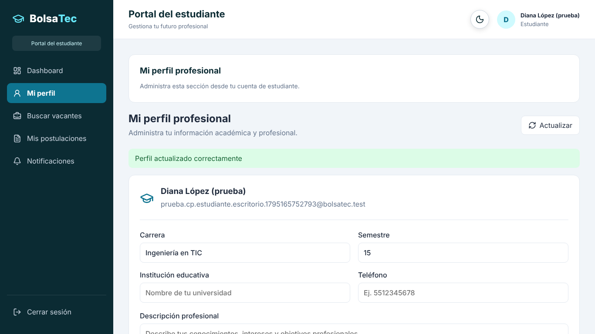

**CP05 — Semestre fuera de rango**

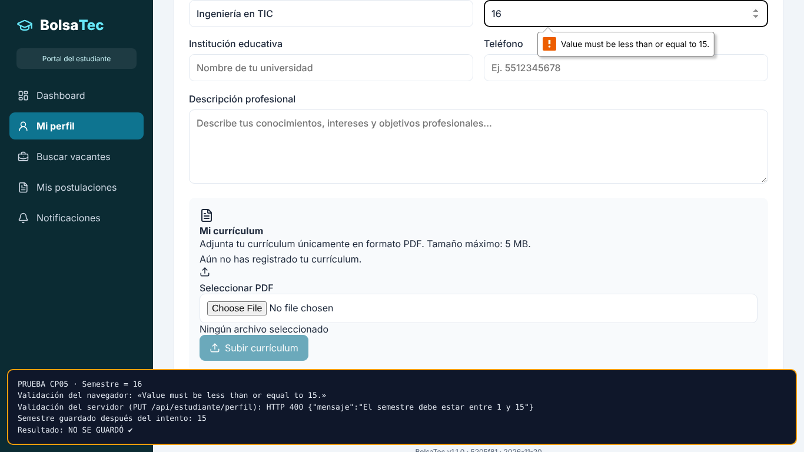

**CP06 — Currículum PDF válido**

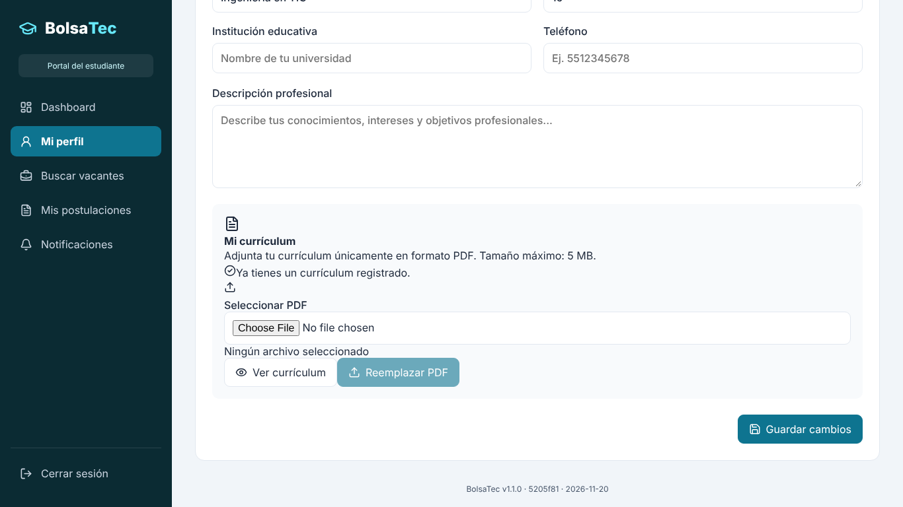

**CP07 — Archivo que no es PDF**

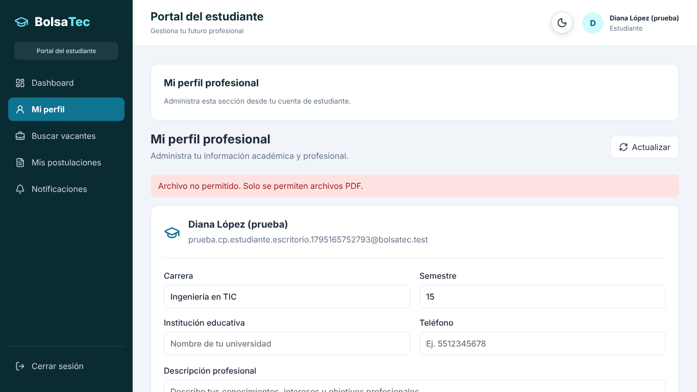

**CP08 — Publicación de vacante**

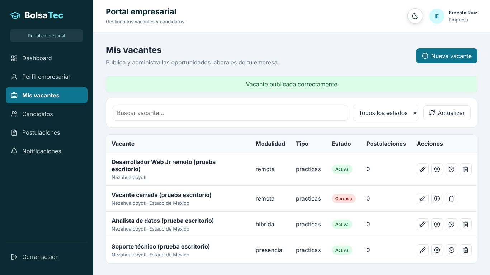

**CP09 — Filtro por modalidad**

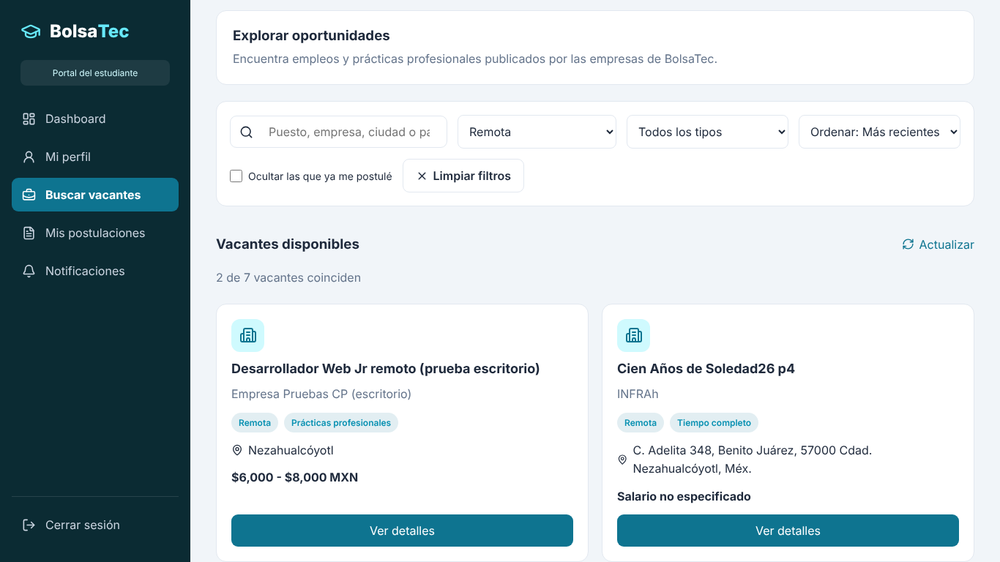

**CP10 — Consulta y detalle de vacante**

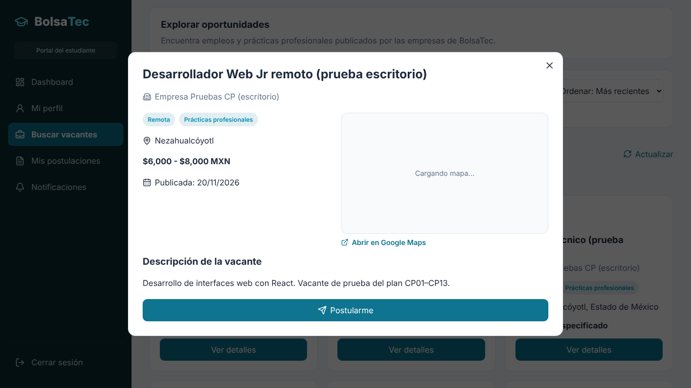

**CP11 — Postulación a vacante activa**

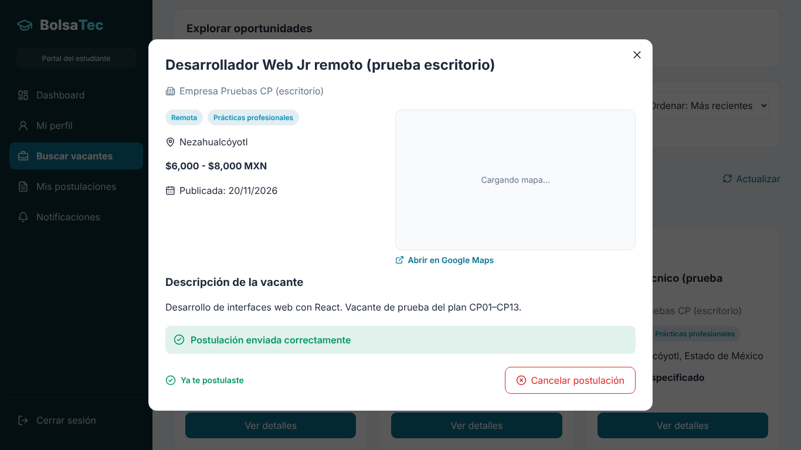

**CP12 — Postulación duplicada**

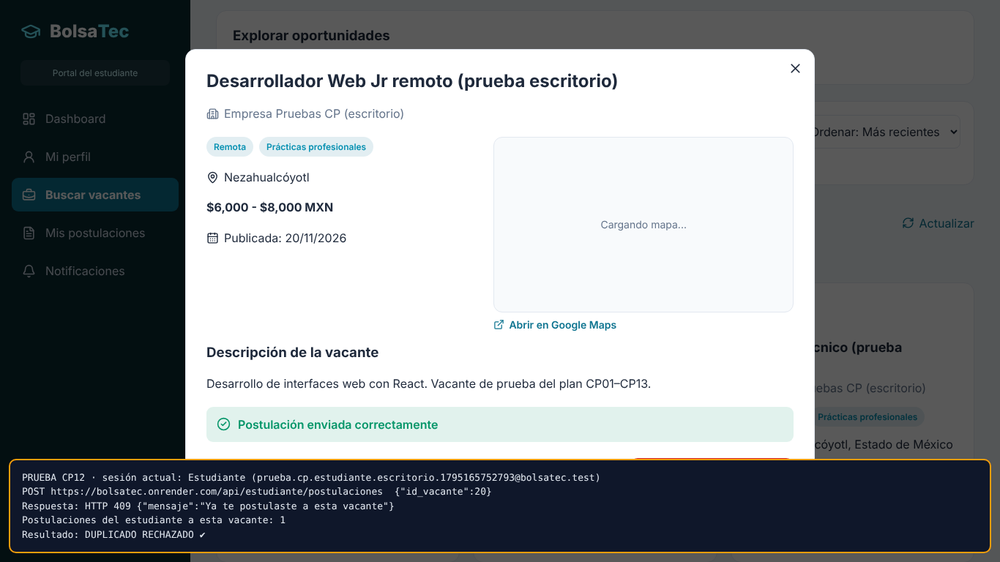

**CP13 — Postulación a vacante cerrada**

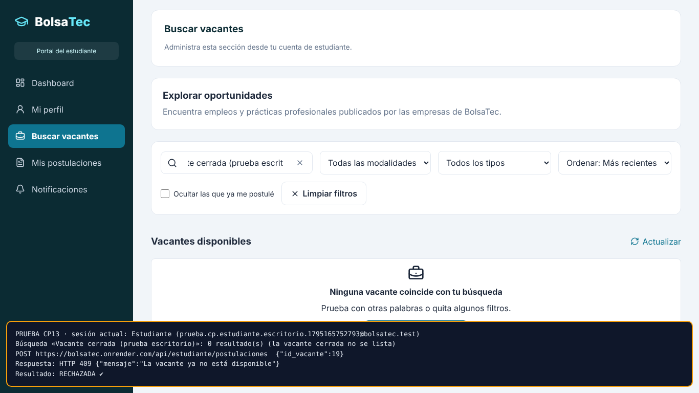

## Móvil (Pixel 7, 412×915)

Cuentas: estudiante `prueba.cp.estudiante.movil.1795165784599@bolsatec.test`, empresa `prueba.cp.empresa.movil.1795165784599@bolsatec.test`.

| ID | Caso | Pasos | Datos | Resultado esperado | Resultado obtenido | Estado | Captura |
|---|---|---|---|---|---|---|---|
| CP01 | Registro de estudiante | Abrir /registro → «Soy estudiante» → llenar nombre, teléfono, institución, carrera, correo y contraseña → aceptar términos → «Crear cuenta». | Nombre «Diana López (prueba)», correo prueba.cp.estudiante.movil.1795165784599@bolsatec.test, contraseña Prueba12345. | La cuenta se registra con rol estudiante y el sistema confirma la operación. | HTTP 201 «Estudiante registrado correctamente»; rol «estudiante»; redirige a /login. | ✅ Aprobado | [movil-CP01.png](movil-CP01.png) |
| CP02 | Registro con correo existente | Abrir /registro → «Soy estudiante» → llenar el formulario con el mismo correo de CP01 → «Crear cuenta». | Correo ya registrado: prueba.cp.estudiante.movil.1795165784599@bolsatec.test. | El sistema rechaza el registro duplicado y muestra un mensaje. | Mensaje «El correo electrónico ya está registrado»; permanece en /registro. | ✅ Aprobado | [movil-CP02.png](movil-CP02.png) |
| CP03 | Inicio de sesión correcto | Abrir /login → «Soy estudiante» → correo y contraseña de CP01 → «Iniciar sesión». | Correo prueba.cp.estudiante.movil.1795165784599@bolsatec.test, contraseña Prueba12345. | El usuario accede a su panel según el rol. | Redirige a /dashboard/estudiante («Portal del estudiante»); pie «BolsaTec v1.1.0 · 5205f81 · 2026-11-20». | ✅ Aprobado | [movil-CP03.png](movil-CP03.png) |
| CP04 | Semestre dentro del rango | Mi perfil → Semestre = 1 → «Guardar cambios»; después Semestre = 15 → «Guardar cambios». | Semestre 1 y semestre 15. | La información se guarda y se muestra actualizada. | Error: locator.click: Timeout 30000ms exceeded. | ❌ Fallido | [movil-CP04.png](movil-CP04.png) |
| CP05 | Semestre fuera de rango | Mi perfil → Semestre = 16 → «Guardar cambios». Además se envía PUT /api/estudiante/perfil con semestre 16 para revisar la validación del servidor. | Semestre 16. | La validación impide guardar el dato. | Error: locator.click: Timeout 30000ms exceeded. | ❌ Fallido | [movil-CP05.png](movil-CP05.png) |
| CP06 | Currículum PDF válido | Mi perfil → «Seleccionar PDF» → elegir el archivo → «Subir currículum». | Curriculum_prueba.pdf (1 página, < 1 KB). | El archivo se asocia al estudiante autenticado. | «Currículum guardado correctamente»; GET /api/estudiante/curriculum: HTTP 200. | ✅ Aprobado | [movil-CP06.png](movil-CP06.png) |
| CP07 | Archivo que no es PDF | Mi perfil → «Seleccionar PDF» → elegir un archivo .txt. | Curriculum_prueba.txt (texto plano). | El archivo se rechaza y se informa el formato permitido. | Mensaje «Archivo no permitido. Solo se permiten archivos PDF.»; el archivo no se envía. | ✅ Aprobado | [movil-CP07.png](movil-CP07.png) |
| CP08 | Publicación de vacante | Iniciar sesión como empresa → Mis vacantes → «Nueva vacante» → llenar campos obligatorios → «Publicar vacante». | Empresa prueba.cp.empresa.movil.1795165784599@bolsatec.test; título «Desarrollador Web Jr remoto (prueba movil)», Remota, Prácticas, salario 6000–8000. | La vacante se registra asociada a esa empresa. | «Vacante publicada correctamente»; estado «activa»; la vacante 24 aparece en «Mis vacantes» de Empresa Pruebas CP (movil). | ✅ Aprobado | [movil-CP08.png](movil-CP08.png) |
| CP09 | Filtro por modalidad | Buscar vacantes → filtro «Remota». | Modalidad = Remota. | Se muestran solo las vacantes de la modalidad seleccionada. | 2 vacante(s), todas con etiqueta «Remota»: sí. Incluye la vacante remota de prueba: sí; oculta la presencial y la híbrida de prueba: sí. | ✅ Aprobado | [movil-CP09.png](movil-CP09.png) |
| CP10 | Consulta y detalle de vacante | Buscar vacantes → quitar filtro → «Ver detalles» en la vacante remota de prueba. | Vacante «Desarrollador Web Jr remoto (prueba movil)». | Se muestran datos principales y detalle de la vacante. | El detalle muestra título, empresa, modalidad, ubicación y descripción (4/4 datos verificados). | ✅ Aprobado | [movil-CP10.png](movil-CP10.png) |
| CP11 | Postulación a vacante activa | En el detalle de la vacante → «Postularme». | Estudiante prueba.cp.estudiante.movil.1795165784599@bolsatec.test; vacante «Desarrollador Web Jr remoto (prueba movil)» sin solicitud previa. | Se crea una postulación y se confirma el registro. | HTTP 201 «Postulación enviada correctamente»; el detalle cambia a «Ya te postulaste». | ✅ Aprobado | [movil-CP11.png](movil-CP11.png) |
| CP12 | Postulación duplicada | Con la misma sesión se intenta postular otra vez a la misma vacante (POST /api/estudiante/postulaciones). | Mismo estudiante y vacante 24. | La segunda solicitud se rechaza por duplicidad. | HTTP 409 «Ya te postulaste a esta vacante»; el estudiante sigue con 1 postulación a esa vacante; el botón muestra «Ya te postulaste». | ✅ Aprobado | [movil-CP12.png](movil-CP12.png) |
| CP13 | Postulación a vacante cerrada | La empresa cierra una vacante. El estudiante busca la vacante y, con su sesión, envía POST /api/estudiante/postulaciones. | Vacante «Vacante cerrada (prueba movil)» (id 23), estado cerrada. | El sistema no permite crear la solicitud. | La vacante cerrada no aparece en la búsqueda (0 resultados). HTTP 409 «La vacante ya no está disponible»; no se crea la postulación. | ✅ Aprobado | [movil-CP13.png](movil-CP13.png) |

**CP01 — Registro de estudiante**

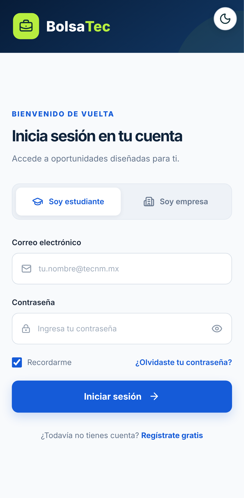

**CP02 — Registro con correo existente**

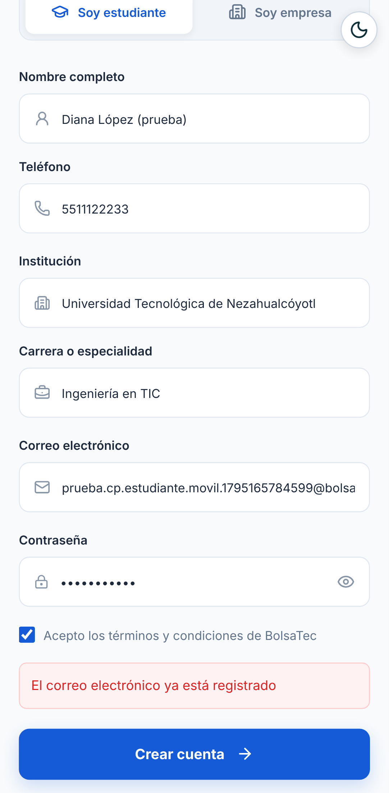

**CP03 — Inicio de sesión correcto**

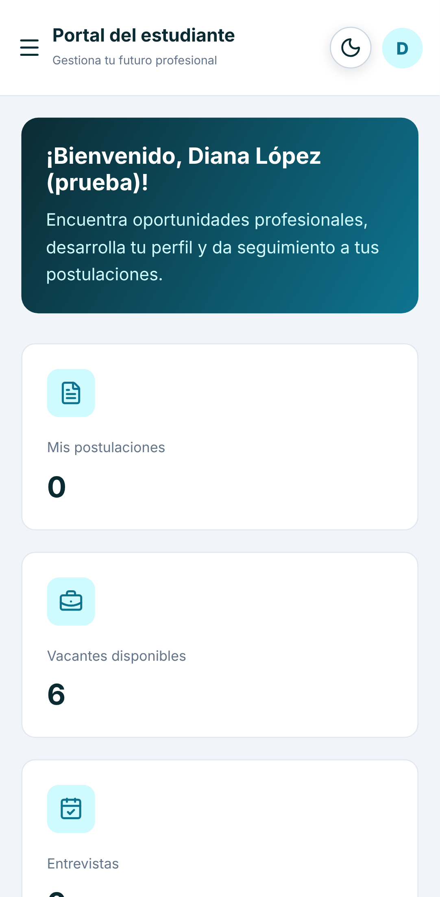

**CP04 — Semestre dentro del rango**

**CP05 — Semestre fuera de rango**

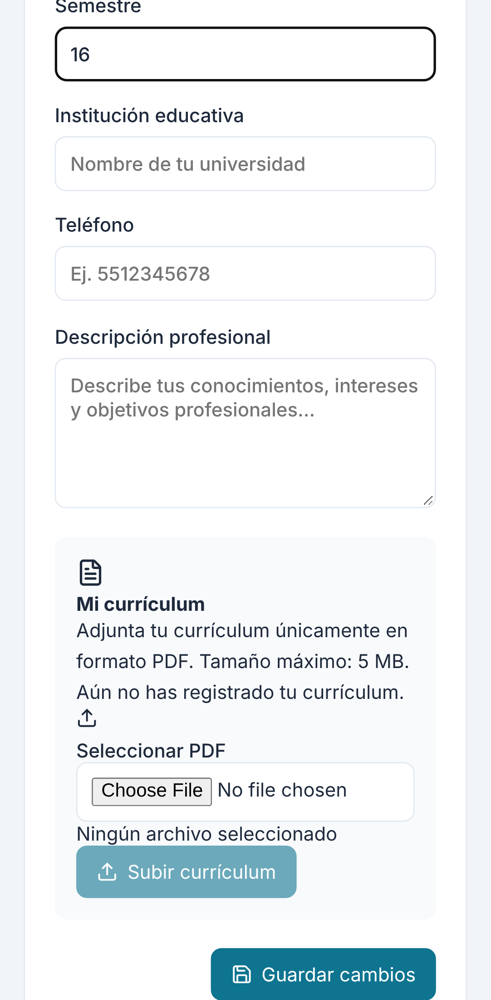

**CP06 — Currículum PDF válido**

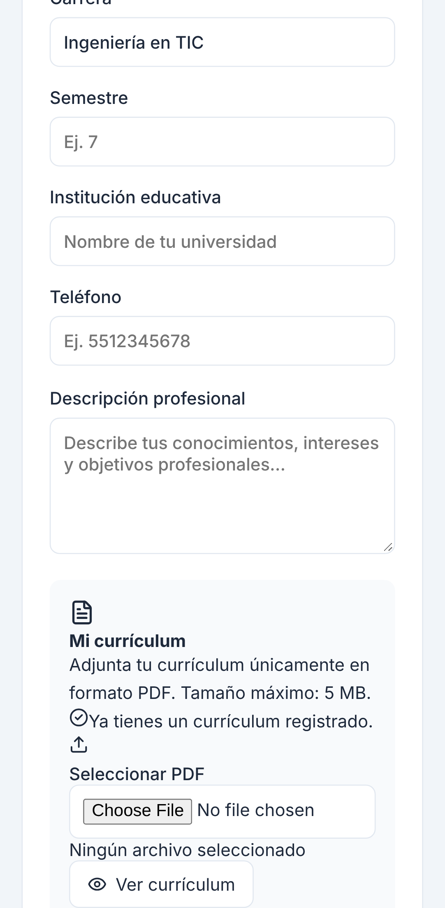

**CP07 — Archivo que no es PDF**

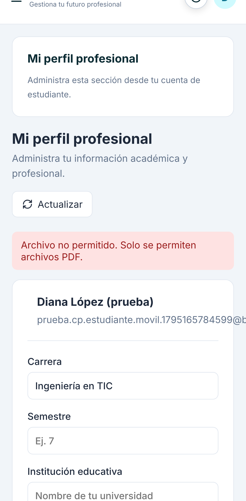

**CP08 — Publicación de vacante**

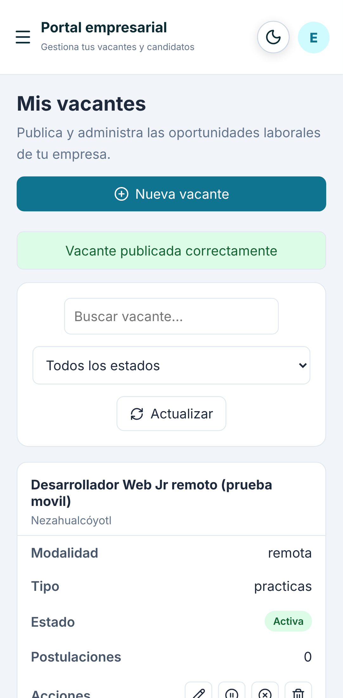

**CP09 — Filtro por modalidad**

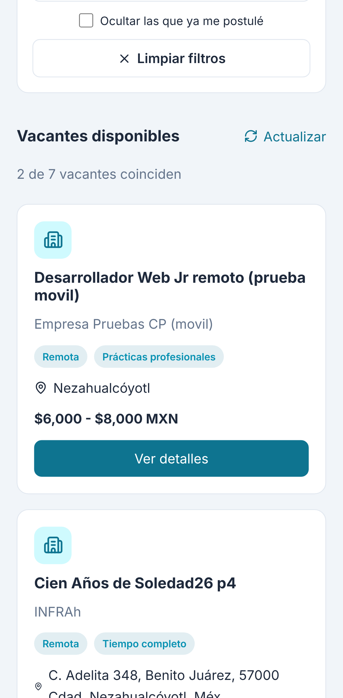

**CP10 — Consulta y detalle de vacante**

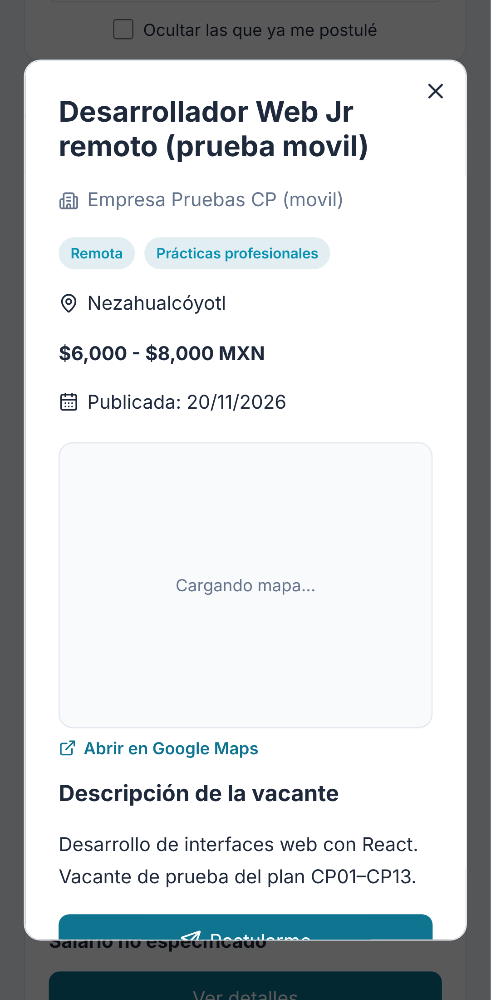

**CP11 — Postulación a vacante activa**

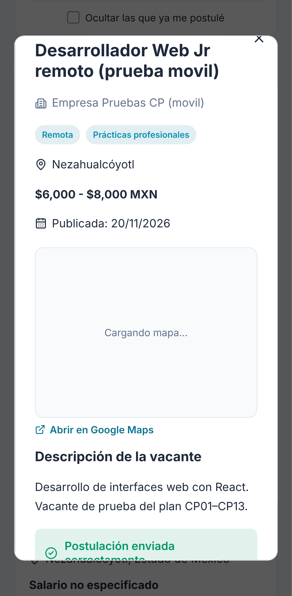

**CP12 — Postulación duplicada**

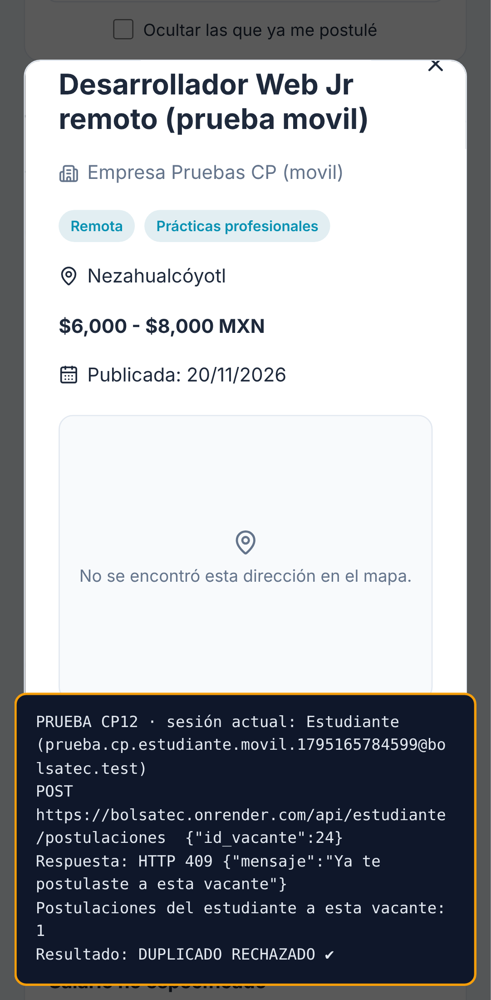

**CP13 — Postulación a vacante cerrada**

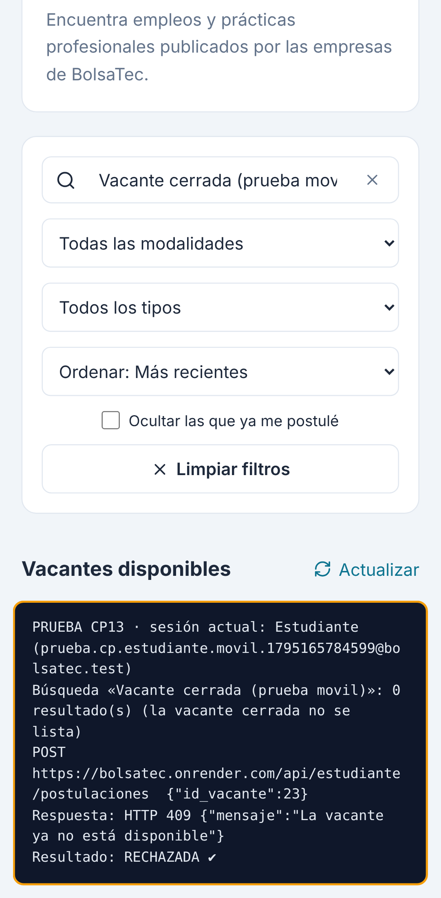
