# Evidencia visual: propiedad de vacantes (escritorio y móvil)

| Dato | Valor |
|---|---|
| Versión de la API | v1.1.0 (commit `5205f81`) |
| Frontend probado | http://localhost:5173 |
| API probada | http://localhost:3000 |
| Navegador | Chromium (Playwright) |
| Fecha de ejecución | 2026-11-20 09:37:30 UTC |
| Resultado | **22 de 22 pasos aprobados** |

Contraseña de todas las cuentas de prueba: `Prueba12345`.

## Escritorio (Chromium 1366×768)

Cuentas: Empresa A = `prueba.empresa.a.escritorio.1795167437095@bolsatec.test`, Empresa B = `prueba.empresa.b.escritorio.1795167437095@bolsatec.test`

| # | Caso | Pasos | Datos | Resultado esperado | Resultado obtenido | Estado | Captura |
|---|---|---|---|---|---|---|---|
| 1 | CP-01 | Empresa A inicia sesión en /login ("Soy empresa") | correo=prueba.empresa.a.escritorio.1795167437095@bolsatec.test | Entra al portal empresarial y se ve la versión de la app | Portal empresarial abierto; pie: "BolsaTec v1.1.0 · 5205f81 · 2026-11-20" | ✅ Aprobado | [escritorio-01.png](escritorio-01.png) |
| 2 | CP-02 | Empresa A → Mis vacantes → Nueva vacante → Publicar | titulo="Desarrollador Web Jr (escritorio)", modalidad=Híbrida, tipo=Prácticas, salario 6000–8000 | Mensaje "Vacante publicada correctamente" y la vacante aparece "activa" | "Vacante publicada correctamente"; estado en la tabla: "activa" | ✅ Aprobado | [escritorio-02.png](escritorio-02.png) |
| 3 | CP-04 | Empresa A → botón Editar → cambia título y salario → Guardar cambios | titulo="Desarrollador Web Jr (escritorio) EDITADA", salario_max=9000 | Mensaje "Vacante actualizada correctamente" y el nuevo título en la tabla | "Vacante actualizada correctamente"; la tabla muestra "Desarrollador Web Jr (escritorio) EDITADA" | ✅ Aprobado | [escritorio-03.png](escritorio-03.png) |
| 4 | CP-05 | Empresa A → botón Pausar → confirmar | estado=pausada | La vacante cambia a "pausada" | Estado en la tabla: "pausada" | ✅ Aprobado | [escritorio-04.png](escritorio-04.png) |
| 5 | CP-06 | Empresa A → botón Activar → confirmar | estado=activa | La vacante vuelve a "activa" | Estado en la tabla: "activa" | ✅ Aprobado | [escritorio-05.png](escritorio-05.png) |
| 6 | CP-07 | Empresa B inicia sesión → Mis vacantes | correo=prueba.empresa.b.escritorio.1795167437095@bolsatec.test | La vacante de Empresa A NO aparece en la lista de Empresa B | La vacante de A no aparece (tabla: "No se encontraron vacantes.") | ✅ Aprobado | [escritorio-06.png](escritorio-06.png) |
| 7 | CP-08 | Con la sesión de Empresa B se envía una edición a la vacante de A | id_vacante=2, titulo="MODIFICADA POR OTRA EMPRESA" | HTTP 404 "Vacante no encontrada"; la vacante de A no cambia | HTTP 404 "Vacante no encontrada"; vacante de A sin cambios | ✅ Aprobado | [escritorio-07.png](escritorio-07.png) |
| 8 | CP-09 | Con la sesión de Empresa B se intenta cerrar la vacante de A | id_vacante=2, estado=cerrada | HTTP 404 "Vacante no encontrada"; la vacante de A no cambia | HTTP 404 "Vacante no encontrada"; vacante de A sin cambios | ✅ Aprobado | [escritorio-08.png](escritorio-08.png) |
| 9 | CP-10 | Con la sesión de Empresa B se intenta eliminar la vacante de A | id_vacante=2 | HTTP 404 "Vacante no encontrada"; la vacante de A no cambia | HTTP 404 "Vacante no encontrada"; vacante de A sin cambios | ✅ Aprobado | [escritorio-09.png](escritorio-09.png) |
| 10 | CP-08/09/10 | Empresa A vuelve a iniciar sesión → Mis vacantes | correo=prueba.empresa.a.escritorio.1795167437095@bolsatec.test | La vacante sigue con el título "Desarrollador Web Jr (escritorio) EDITADA" y estado "activa" | Vacante presente, estado "activa" | ✅ Aprobado | [escritorio-10.png](escritorio-10.png) |
| 11 | CP-14 | Empresa A → botón Eliminar → confirmar | id_vacante=2 | Mensaje "Vacante eliminada correctamente" y la vacante desaparece | "Vacante eliminada correctamente"; ya no aparece en la tabla | ✅ Aprobado | [escritorio-11.png](escritorio-11.png) |

**1. CP-01 — Empresa A inicia sesión en /login ("Soy empresa")**

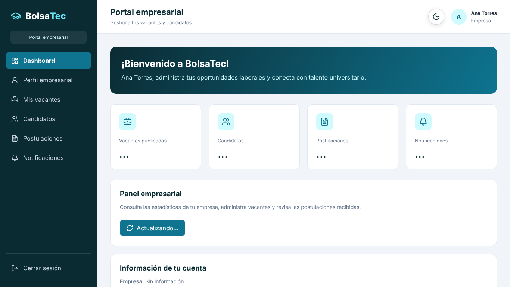

**2. CP-02 — Empresa A → Mis vacantes → Nueva vacante → Publicar**

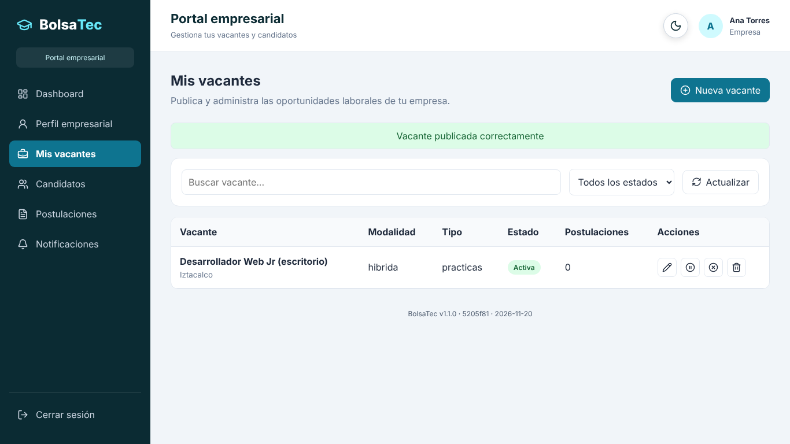

**3. CP-04 — Empresa A → botón Editar → cambia título y salario → Guardar cambios**

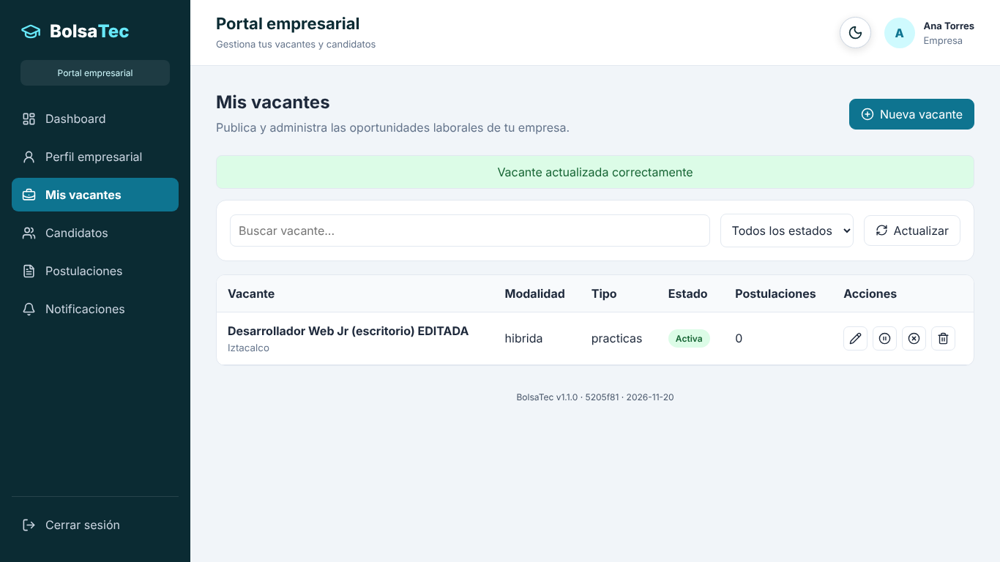

**4. CP-05 — Empresa A → botón Pausar → confirmar**

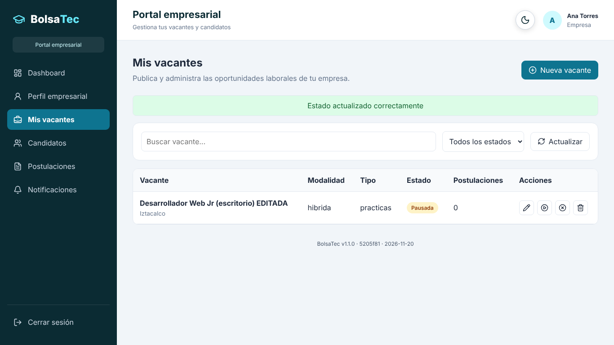

**5. CP-06 — Empresa A → botón Activar → confirmar**

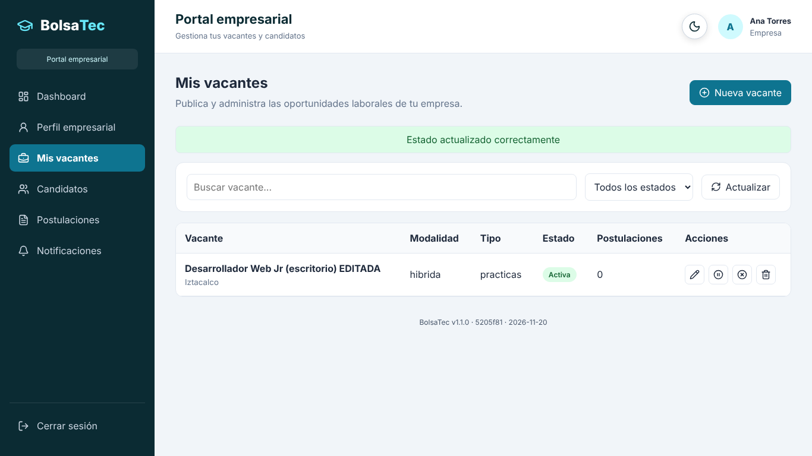

**6. CP-07 — Empresa B inicia sesión → Mis vacantes**

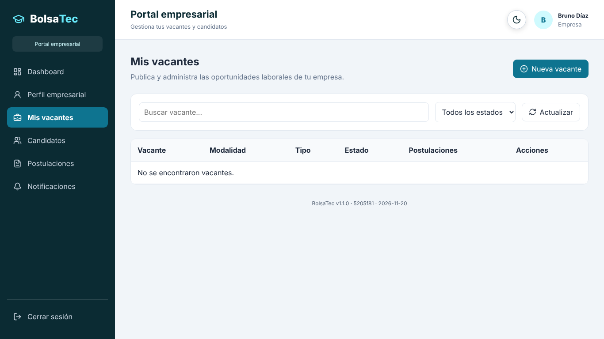

**7. CP-08 — Con la sesión de Empresa B se envía una edición a la vacante de A**

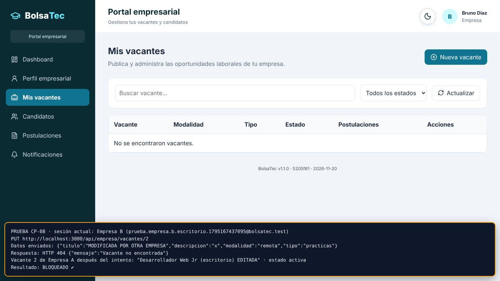

**8. CP-09 — Con la sesión de Empresa B se intenta cerrar la vacante de A**

**9. CP-10 — Con la sesión de Empresa B se intenta eliminar la vacante de A**

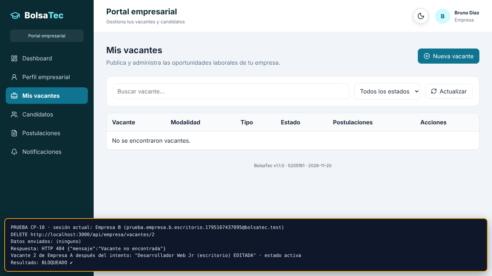

**10. CP-08/09/10 — Empresa A vuelve a iniciar sesión → Mis vacantes**

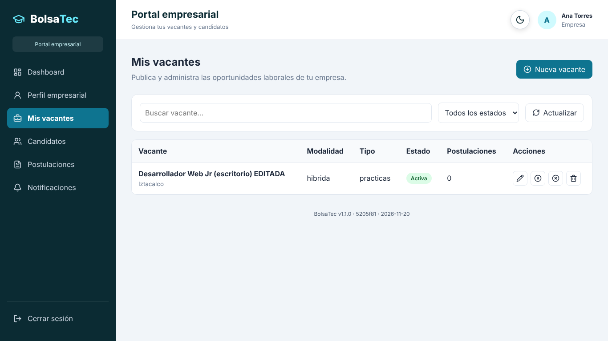

**11. CP-14 — Empresa A → botón Eliminar → confirmar**

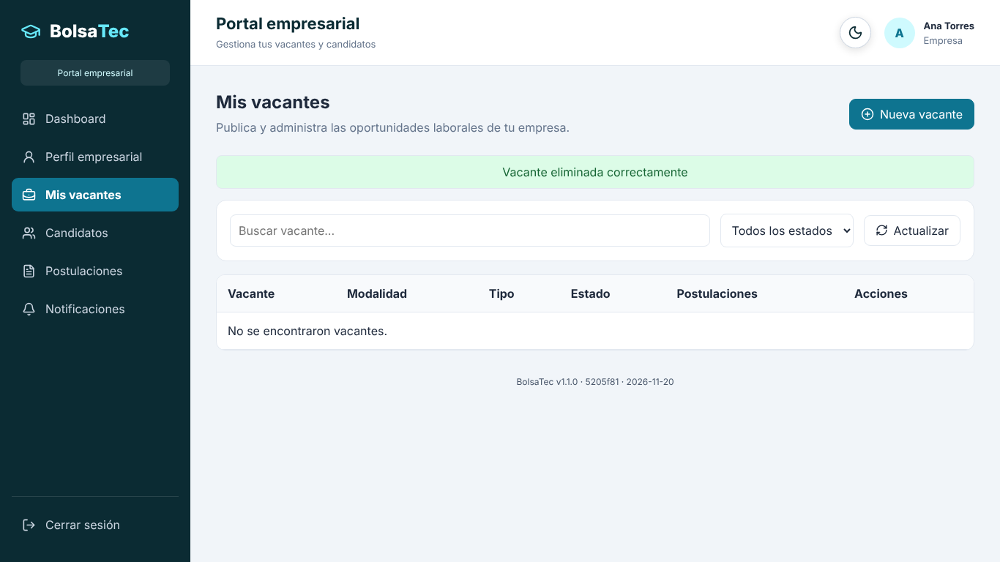

## Móvil (Pixel 7, 412×915)

Cuentas: Empresa A = `prueba.empresa.a.movil.1795167442816@bolsatec.test`, Empresa B = `prueba.empresa.b.movil.1795167442816@bolsatec.test`

| # | Caso | Pasos | Datos | Resultado esperado | Resultado obtenido | Estado | Captura |
|---|---|---|---|---|---|---|---|
| 1 | CP-01 | Empresa A inicia sesión en /login ("Soy empresa") | correo=prueba.empresa.a.movil.1795167442816@bolsatec.test | Entra al portal empresarial y se ve la versión de la app | Portal empresarial abierto; pie: "BolsaTec v1.1.0 · 5205f81 · 2026-11-20" | ✅ Aprobado | [movil-01.png](movil-01.png) |
| 2 | CP-02 | Empresa A → Mis vacantes → Nueva vacante → Publicar | titulo="Desarrollador Web Jr (movil)", modalidad=Híbrida, tipo=Prácticas, salario 6000–8000 | Mensaje "Vacante publicada correctamente" y la vacante aparece "activa" | "Vacante publicada correctamente"; estado en la tabla: "activa" | ✅ Aprobado | [movil-02.png](movil-02.png) |
| 3 | CP-04 | Empresa A → botón Editar → cambia título y salario → Guardar cambios | titulo="Desarrollador Web Jr (movil) EDITADA", salario_max=9000 | Mensaje "Vacante actualizada correctamente" y el nuevo título en la tabla | "Vacante actualizada correctamente"; la tabla muestra "Desarrollador Web Jr (movil) EDITADA" | ✅ Aprobado | [movil-03.png](movil-03.png) |
| 4 | CP-05 | Empresa A → botón Pausar → confirmar | estado=pausada | La vacante cambia a "pausada" | Estado en la tabla: "pausada" | ✅ Aprobado | [movil-04.png](movil-04.png) |
| 5 | CP-06 | Empresa A → botón Activar → confirmar | estado=activa | La vacante vuelve a "activa" | Estado en la tabla: "activa" | ✅ Aprobado | [movil-05.png](movil-05.png) |
| 6 | CP-07 | Empresa B inicia sesión → Mis vacantes | correo=prueba.empresa.b.movil.1795167442816@bolsatec.test | La vacante de Empresa A NO aparece en la lista de Empresa B | La vacante de A no aparece (tabla: "No se encontraron vacantes.") | ✅ Aprobado | [movil-06.png](movil-06.png) |
| 7 | CP-08 | Con la sesión de Empresa B se envía una edición a la vacante de A | id_vacante=3, titulo="MODIFICADA POR OTRA EMPRESA" | HTTP 404 "Vacante no encontrada"; la vacante de A no cambia | HTTP 404 "Vacante no encontrada"; vacante de A sin cambios | ✅ Aprobado | [movil-07.png](movil-07.png) |
| 8 | CP-09 | Con la sesión de Empresa B se intenta cerrar la vacante de A | id_vacante=3, estado=cerrada | HTTP 404 "Vacante no encontrada"; la vacante de A no cambia | HTTP 404 "Vacante no encontrada"; vacante de A sin cambios | ✅ Aprobado | [movil-08.png](movil-08.png) |
| 9 | CP-10 | Con la sesión de Empresa B se intenta eliminar la vacante de A | id_vacante=3 | HTTP 404 "Vacante no encontrada"; la vacante de A no cambia | HTTP 404 "Vacante no encontrada"; vacante de A sin cambios | ✅ Aprobado | [movil-09.png](movil-09.png) |
| 10 | CP-08/09/10 | Empresa A vuelve a iniciar sesión → Mis vacantes | correo=prueba.empresa.a.movil.1795167442816@bolsatec.test | La vacante sigue con el título "Desarrollador Web Jr (movil) EDITADA" y estado "activa" | Vacante presente, estado "activa" | ✅ Aprobado | [movil-10.png](movil-10.png) |
| 11 | CP-14 | Empresa A → botón Eliminar → confirmar | id_vacante=3 | Mensaje "Vacante eliminada correctamente" y la vacante desaparece | "Vacante eliminada correctamente"; ya no aparece en la tabla | ✅ Aprobado | [movil-11.png](movil-11.png) |

**1. CP-01 — Empresa A inicia sesión en /login ("Soy empresa")**

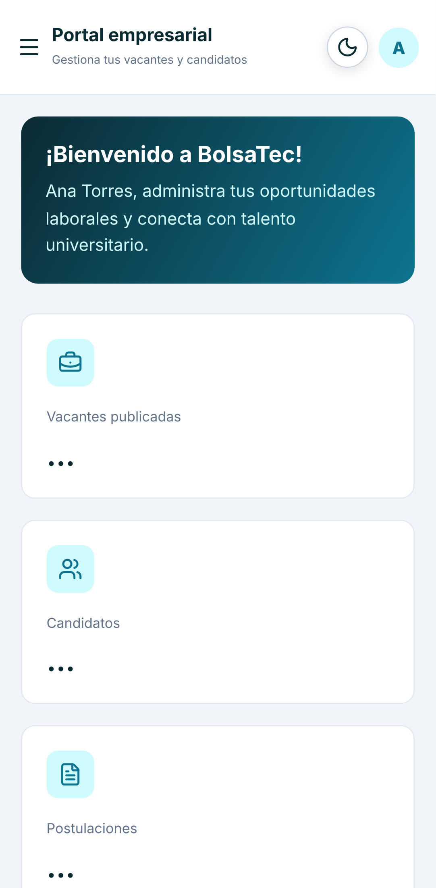

**2. CP-02 — Empresa A → Mis vacantes → Nueva vacante → Publicar**

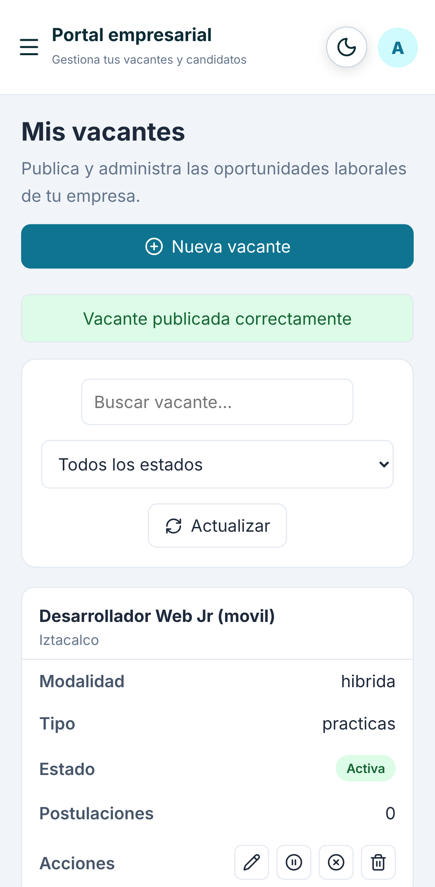

**3. CP-04 — Empresa A → botón Editar → cambia título y salario → Guardar cambios**

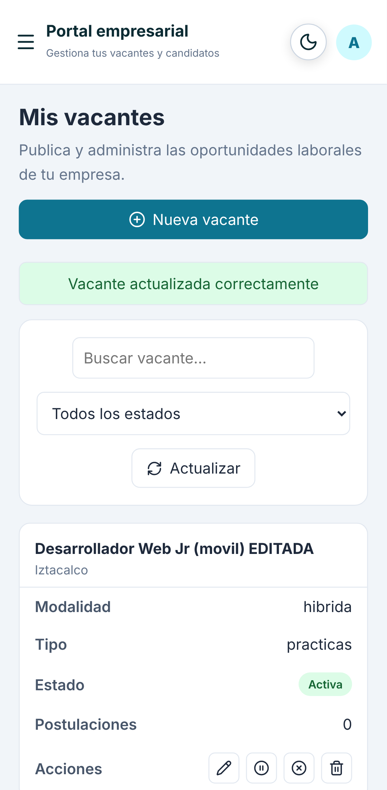

**4. CP-05 — Empresa A → botón Pausar → confirmar**

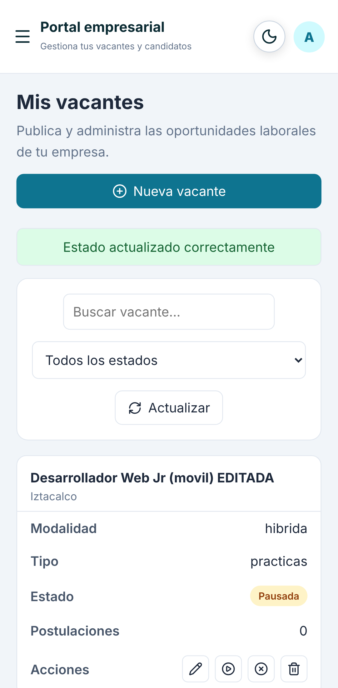

**5. CP-06 — Empresa A → botón Activar → confirmar**

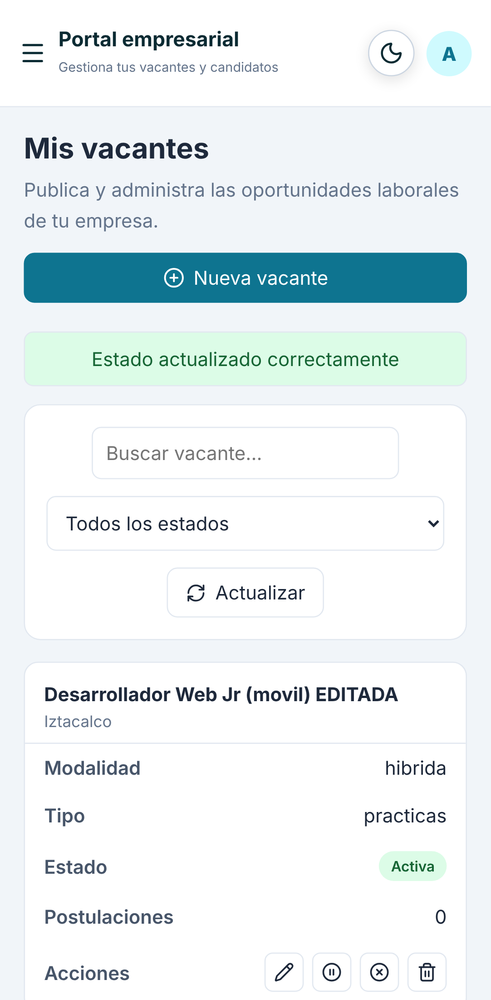

**6. CP-07 — Empresa B inicia sesión → Mis vacantes**

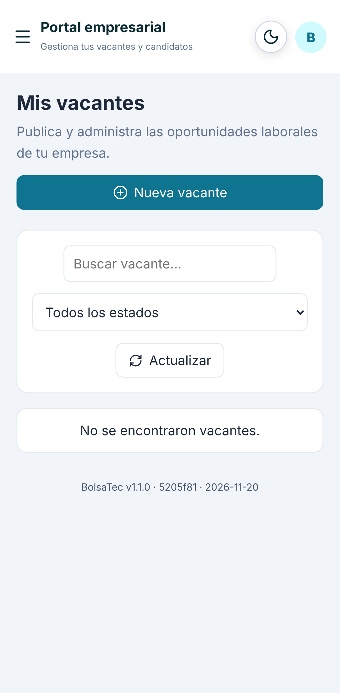

**7. CP-08 — Con la sesión de Empresa B se envía una edición a la vacante de A**

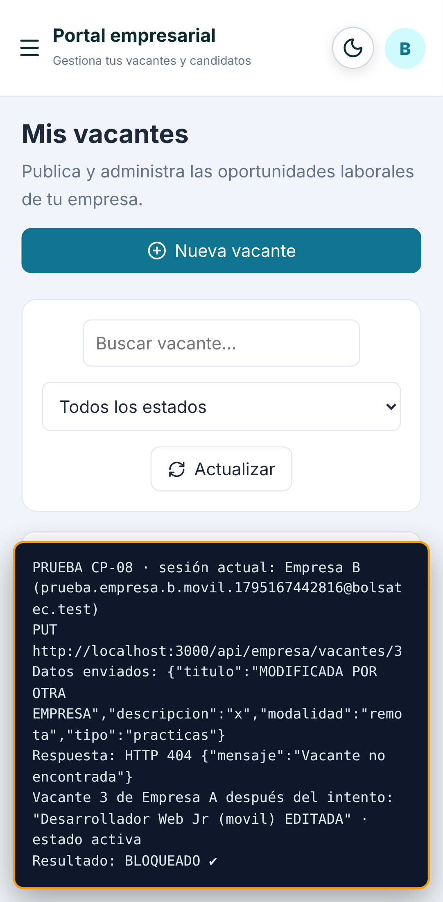

**8. CP-09 — Con la sesión de Empresa B se intenta cerrar la vacante de A**

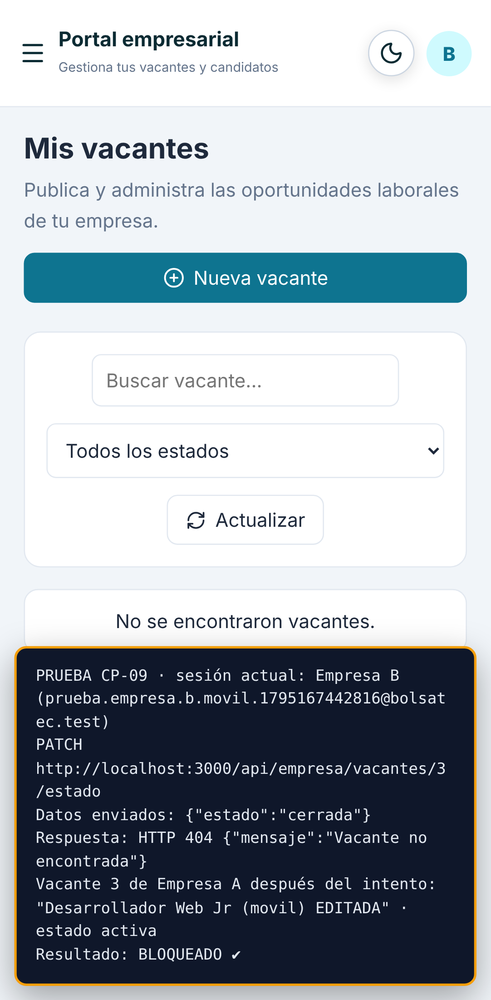

**9. CP-10 — Con la sesión de Empresa B se intenta eliminar la vacante de A**

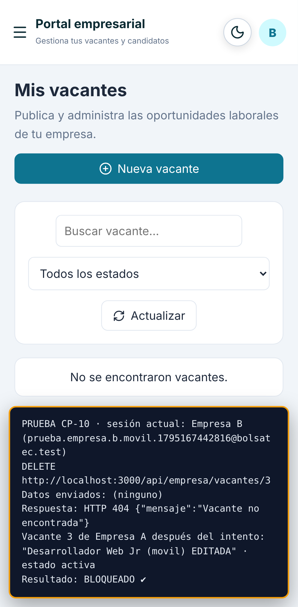

**10. CP-08/09/10 — Empresa A vuelve a iniciar sesión → Mis vacantes**

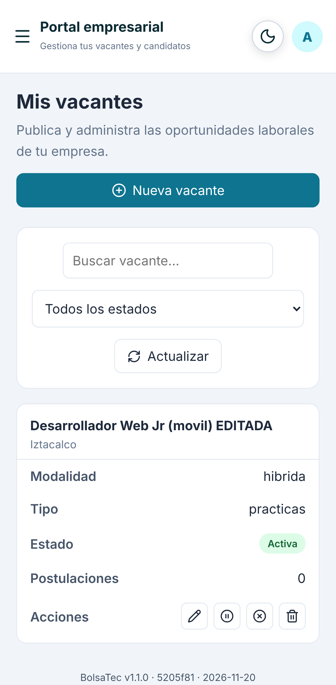

**11. CP-14 — Empresa A → botón Eliminar → confirmar**

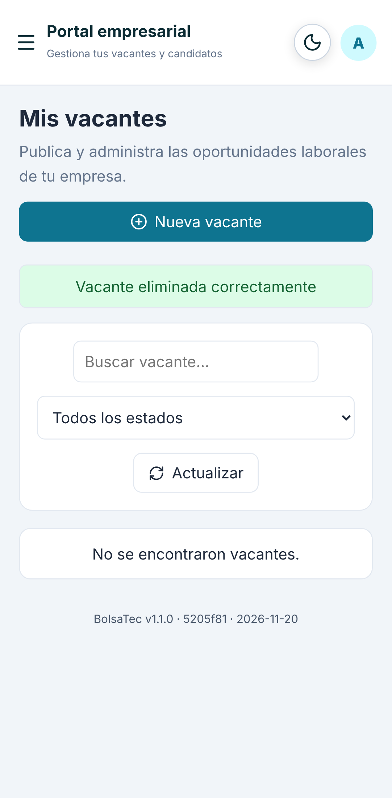
